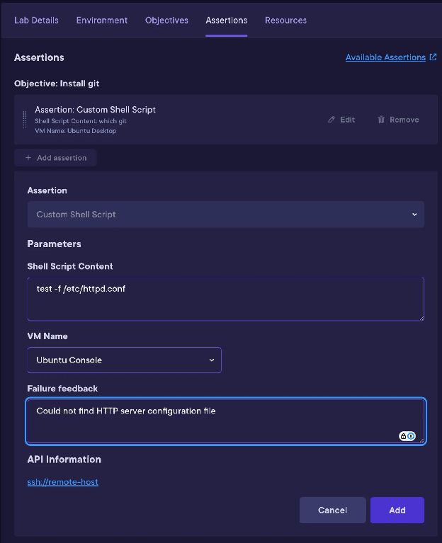
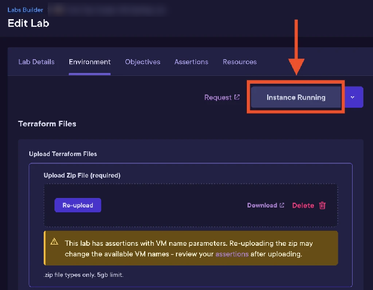
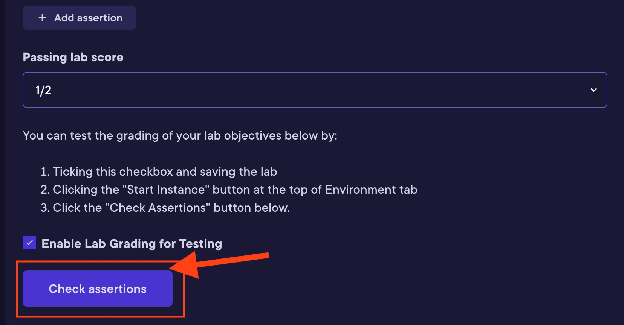

# Desktop Labs: VM Assertions

> **About this sample**
>
> - **Type:** Developer-facing reference and how-to documentation
> - **Audience:** Lab authors building Desktop Labs at Pluralsight
> - **My role:** Drafted and edited this guide for the lab author kit, and tested the workflow in Labs Builder
> - **Standards:** Google Developer Documentation Style Guide and Pluralsight content standards
>
> Internal links have been removed and identifying details in screenshots have been blurred.

VM assertions let you validate a learner's progress from within a Desktop Lab virtual machine (VM). You can use VM assertions to check conditions such as whether:

- A file exists.
- A process is running.
- A required firewall port is open.
- A file contains a specific string.

## How VM assertions work

The VM assertion system connects to a VM by using SSH, runs a command that you specify, and collects the exit code, standard output (stdout), and standard error (stderr). The assertion uses the command's exit code to determine whether the check passes or fails:

- An exit code of `0` means the assertion passes.
- Any nonzero exit code means the assertion fails.

Learners don't see stdout or stderr. You can see both, which helps you debug your assertion commands.

> **Important:** Make sure the VM supports SSH authentication and that the SSH user has permission to run the commands your assertion requires.

## Desktop Lab compatibility

Currently, only Desktop Labs support VM assertions. Support for other lab types that use VMs is planned.

Desktop Labs provisioned with the latest compatible version of the lab Terraform template include the VM configuration that VM assertions require.

## Add a VM assertion to your lab

Use a **Custom Shell Script Assertion** to run a shell command against a VM in your Desktop Lab.

To add a VM assertion:

1. In **Labs Builder**, open the **Assertions** tab.
2. Under the objective you want to validate, click **+ Add assertion**.
3. Select **Custom Shell Script Assertion**.
4. Enter the required assertion parameters.
5. Optional: Enter **Failure Feedback** to show learners a message when the assertion fails.
6. Click **Save Changes**.



### Custom Shell Script Assertion parameters

| Parameter | Required | Description |
| :-- | :-- | :-- |
| Shell Script Content | Yes | A single shell command that returns exit code `0` when the check succeeds and a nonzero exit code when it fails. |
| VM Name | Yes | The name of the VM that the command runs on. |
| Failure Feedback | No | A message shown to the learner when the assertion fails. |

### Write the shell script content

Enter a single, valid shell command in **Shell Script Content**. The command must return an appropriate exit code:

- `0`: The assertion passes.
- Any nonzero exit code: The assertion fails.

Use commands that are compatible with the VM's operating system and environment. For example, use Bash commands on Linux VMs and PowerShell commands on Windows VMs.

#### Bash examples

Check whether the `/tmp` directory exists:

```sh
test -d /tmp
```

Check whether a file contains a specific string:

```sh
grep -q "MySpecialString" /path/to/file
```

Check whether a file exists and contains valid JSON:

```sh
test -f /path/to/file.json && jq '.' /path/to/file.json
```

Check whether a web server process is running:

```sh
pgrep -x "nginx" || pgrep -x "apache" || pgrep -x "httpd"
```

#### PowerShell examples

Check whether the Windows directory exists:

```powershell
if (Test-Path "C:\Windows") { exit 0 } else { exit 1 }
```

Check whether a process is running:

```powershell
Get-Process -Name "notepad" -ErrorAction SilentlyContinue
```

Check whether a file contains valid JSON:

```powershell
try { Get-Content "C:\Users\Administrator\Desktop\config.json" -ErrorAction Stop | ConvertFrom-Json; exit 0 } catch { exit 1 }
```

> **Note:** PowerShell cmdlets usually return objects instead of setting an exit code that reflects the result of a check. When necessary, use `exit 0` for success and `exit 1` for failure.
>
> Because the grader relies only on exit codes, PowerShell assertions can be more verbose than their Bash equivalents. Contact your assigned Technical Content Producer (TCP) for help simplifying a PowerShell assertion.

### Specify the VM name

The **VM Name** value must exactly match the name of a VM defined in the lab's Terraform configuration.

> **Warning:** If you rename a VM after you create assertions for it, update the **VM Name** value in every assertion that references that VM. Otherwise, those assertions stop working.

## Test VM assertions

Before you publish the lab, test each assertion to confirm that it fails and passes under the expected conditions.

To test your assertions:

1. In the **Environment** tab, click **Start Instance**, and wait for setup to finish.

    

2. Open the **Assertions** tab.
3. Confirm that the lab has at least one **Custom Shell Script Assertion**.
4. Select **Enable Lab Grading for Testing**.
5. Click **Save Changes**.
6. Click **Check assertions**.

    

7. Verify that the assertions for tasks you haven't completed fail.
8. Complete the learner task that should satisfy the first assertion.
9. Click **Check assertions** again.
10. Verify that the completed assertion passes and that the assertions for incomplete tasks still fail.
11. Repeat steps 8 through 10 for each assertion.

When possible, also complete the lab as a learner would. This helps confirm that each assertion passes because the intended task was completed, not because of an unintended condition in the environment.

## Design effective VM assertions

Learners have administrator or root access to Desktop Lab VMs, so don't rely on VM assertions to protect answers or other sensitive information.

- **Verify outcomes:** Check the result of the learner's work instead of exposing an expected answer.
- **Prevent easy workarounds:** Design checks that are harder to bypass. For example, verify a cryptographic hash of a valid answer instead of checking for a plaintext string in a file.
- **Validate meaningful state:** When appropriate, validate a system state or computed result instead of a plaintext answer stored in a file.
- **Provide actionable feedback:** Keep **Failure Feedback** short and specific so learners know what to fix.

## Troubleshoot VM assertions

If an assertion passes or fails unexpectedly:

1. Run the assertion command directly on the target VM.
2. Verify that the command returns exit code `0` for the passing condition.
3. Verify that the command returns a nonzero exit code for the failing condition.
4. Confirm that **VM Name** exactly matches the VM name in the Terraform configuration.
5. Confirm that the SSH user has permission to run the command.
6. Save the lab.
7. Click **Check assertions** again.

If the problem continues, or you see an error you don't understand, contact your assigned TCP or program manager.
